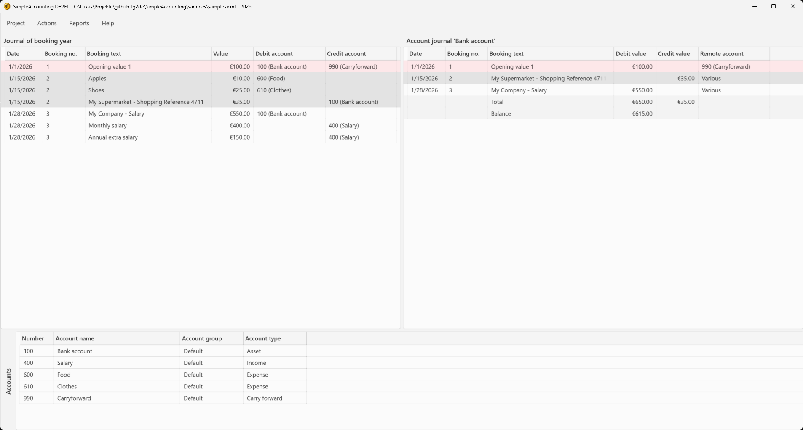
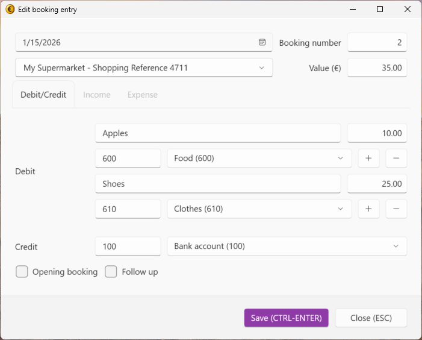
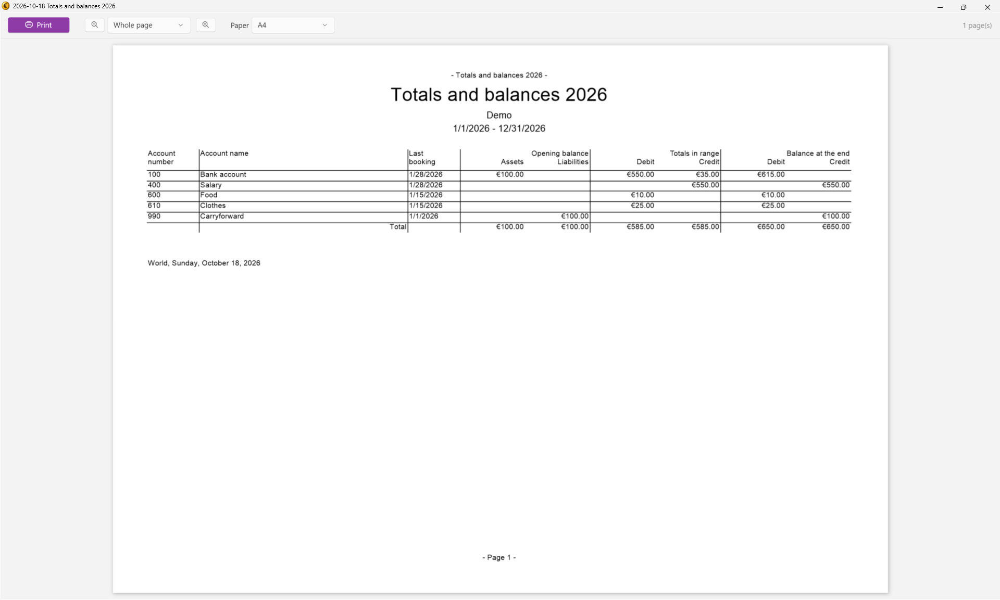
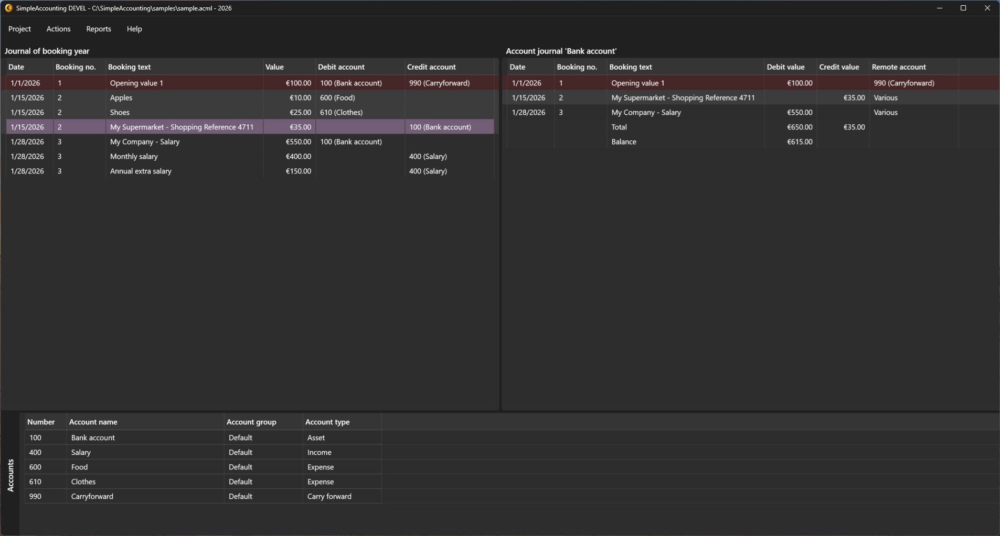
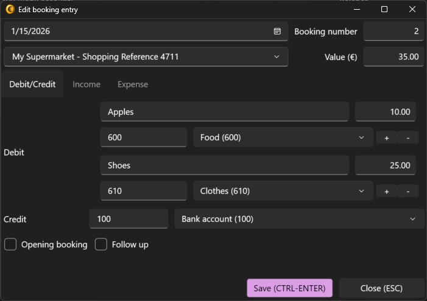
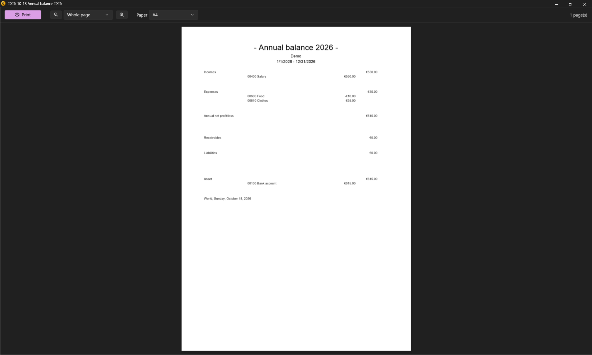

# SimpleAccounting – Simple Accounting Software

**SimpleAccounting** is a simple program for accounting.
It supports double-entry accounting, including split bookings and several reports.
Bookings can be imported from text files (CSV), e.g., provided by your bank account web access.

I started `SimpleAccounting` around 2005, only for my personal use to manage accounts and balances of a small club.
In 2019, I met a colleague from a different small club who was looking for an easy way to see the balances of several accounts, both real and logical.

So, I decided to rework my solution to make it usable for others and open source.

## Naming

The name says it all. The software is as simple as possible. 

It probably does not follow all rules and laws of double-entry accounting, e.g.,
the software does not protect accounting entries from changes.
Instead, it is explicitly possible to change existing entries.
The data is stored in readable XML format and can be changed manually.
An XSD document is available online and linked from the XML document which supports editing with code completion support.

The software focuses on journal and balance sheet reporting.

## Features

* Data management for double-entry accounting, stored as XML (see [example](./samples/sample.acml)) and defined using [XSD](./docs/AccountingData.xsd)
* User interface (English, German, and French) for the management of accounts, the creation and modification of entries,
  the listing of account journals, with Light and Dark theme
* Support for split booking entries, either on the credit or debit side
* Import of booking entries from your bank account using CSV files incl. semi-automatic assignment of offsetting accounts
* Printable reports for full journal, account journal, accounts and balances, and annual financial statements
* Semi-automatic update of the application

Some screenshots for the first impression:

| Main view                                                                         | Split booking                                                                             | Reports                                                                                                        |
|-----------------------------------------------------------------------------------|-------------------------------------------------------------------------------------------|----------------------------------------------------------------------------------------------------------------|
|     |     |  |
|  |  |        |

## Getting started

The application is based on [.NET 10](https://dotnet.microsoft.com/en-us/download/dotnet/10.0).
There is
a [self-contained package](https://github.com/lg2de/SimpleAccounting/releases/download/2.5.0/SimpleAccounting-self-contained.zip)
available.
Using this package, you do not need to install the .NET 10 runtime.
I'll update this package with security fixes if needed.
There is also a [small package](https://github.com/lg2de/SimpleAccounting/releases/download/2.5.0/SimpleAccounting.zip)
available that requires .NET runtime to be installed.
Please download and install the Runtime in
version [10.0](https://dotnet.microsoft.com/en-us/download/dotnet/thank-you/runtime-desktop-10.0.13-windows-x64-installer)
or above.

Download one of the `SimpleAccounting` packages from
the [release page](https://github.com/lg2de/SimpleAccounting/releases).
Extract the ZIP archive into your preferred destination directory.

Start `SimpleAccounting.exe`.

## Contribution

Contributions are welcome!

Small changes can be made immediately via Pull Request.
I will try to check and integrate it as soon as possible.
Medium and large changes should be discussed first.
Please open a new issue or participate in existing discussions.

## TODOs

I am German and have no experience with English or French terms in the financial world.
Therefore, I am pretty sure that some of the words I used are confusing for native speakers.
Perhaps you would like to help with better naming?

## Roadmap

The public releases are [available](https://github.com/lg2de/SimpleAccounting/releases).
Please download, test, and send feedback.

The roadmap is defined by issues and milestones.

## License

I do not like closed source reuse of my software.
This is why I decided to license the software under GPLV3.

The application uses several external packages licensed under [MIT](https://opensource.org/licenses/MIT)
and [Apache 2.0](https://licenses.nuget.org/Apache-2.0).
They are listed with their copyright and license texts in
[THIRD-PARTY-NOTICES.txt](src/SimpleAccounting/THIRD-PARTY-NOTICES.txt), which is shipped with every release.

For the unit tests additional packages are used licensed under
[Apache 2.0](https://licenses.nuget.org/Apache-2.0),
[MS-PL](https://opensource.org/licenses/MS-PL),
and [BSD-3-Clause](https://licenses.nuget.org/BSD-3-Clause).

## Star History

<a href="https://www.star-history.com/?repos=lg2de%2FSimpleAccounting&type=date&releases=&legend=bottom-right">
 <picture>
   <source media="(prefers-color-scheme: dark)" srcset="https://api.star-history.com/chart?repos=lg2de/SimpleAccounting&type=date&theme=dark&legend=bottom-right" />
   <source media="(prefers-color-scheme: light)" srcset="https://api.star-history.com/chart?repos=lg2de/SimpleAccounting&type=date&legend=bottom-right" />
   
 </picture>
</a>
